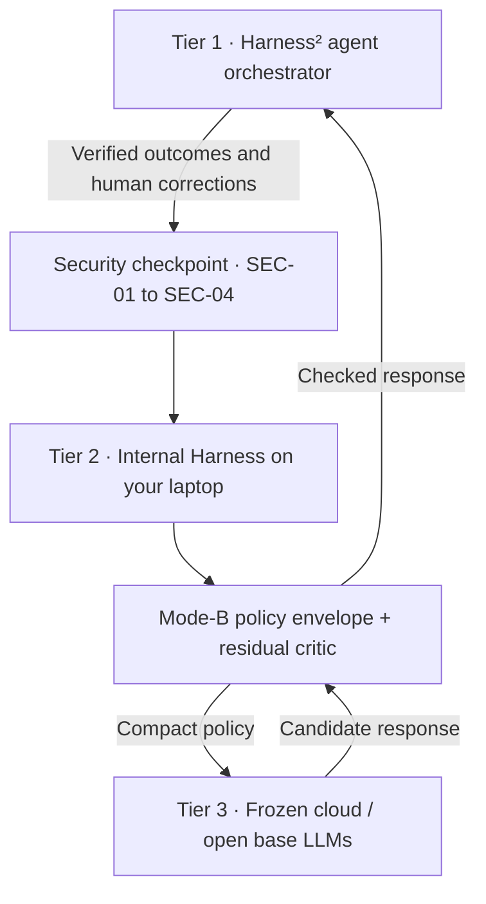

# Internal Harness v2.0: Sovereign Continual Learning Layer for Harness²

> **Built by [Hasnat](https://github.com/Hasnat-GPU) for the OpenAI Codex DevDay Community Hackathon: Berlin, October 24, 2026.**
>
> My hackathon project explores how AI agents can retain useful corrections in locally owned memory, with an interactive UX that makes the architecture understandable to everyone.

## Watch the 60-second narrated demo

🎥 **[Watch the 60-Second Narrated Demo Video (Google Drive)](https://drive.google.com/file/d/1u8OW0lUMhhxG1twcPHh2dPLS1x-La8N1/view?usp=sharing)**

Tour the four stations, teach a rule, watch a synthetic secret get scrubbed, open the engineering inspector, and restore an earlier memory snapshot. Narrated in English with captions and an animated pointer; **60 seconds · 1080p · H.264/AAC**.

**[Download the MP4 from v2.0.0](https://github.com/Hasnat-GPU/internal-harness/releases/download/v2.0.0/harness2_demo_60s.mp4)** · [Release notes](https://github.com/Hasnat-GPU/internal-harness/releases/tag/v2.0.0)

**Explore in your browser:** [Harness² Flight Deck](https://hasnat-gpu.github.io/internal-harness/UI_UX_Frontend.html) · [Backend Blueprint](https://hasnat-gpu.github.io/internal-harness/Blueprint_Backend.html)

> **Release scope:** v2.0.0 publishes the v2.0 specification, interactive frontend, spec-driven build kit, and implemented T03 security/ingestion foundation. The UI and video demonstrate simulated behavior. The badges describe the target architecture; full weight learning, cloud integration, cryptographic rollback, and laptop performance targets are not yet verified end to end.

## Why Internal Harness?

An agent should retain useful corrections without appending its entire history to every prompt. Internal Harness is designed as a locally owned learning layer between the **Harness² agent orchestrator** and **frozen cloud or open-weight base models**.

Its blueprint moves learned habits into small plastic adapters: `fast_state.safetensors` for daily updates and `long_term_state.safetensors` for consolidated memory. The cloud-facing Mode-B bridge turns that memory into a bounded **150-token policy envelope**, so the agent can carry its preferences between base models without an ever-growing history prompt. This still uses a compact textual policy; direct tensor injection is a separate future Mode-A path.

The target is a quiet laptop: WSL2 Ubuntu, an Intel Core i9-13900H, four CPU threads, no NVIDIA CUDA, a whole-process RAM budget of **≤1.5 GB**, and **0.0% CPU while idle**. These are acceptance targets from the [blueprint](Blueprint_Backend.html#sec-1), not measurements of a completed learning engine.

## Three tiers, one locally owned memory

| Tier | Role | Ownership boundary |
| --- | --- | --- |
| 1 — Harness² | Refines prompts, tools, memory policies, and helper-agent routing | Sends verified learning events |
| 2 — Internal Harness | Stores episodes and learns small local weight updates | Keeps private rules and adapters on your laptop |
| 3 — Frozen base LLMs | Performs complex reasoning guided by the policy envelope | Base weights remain unchanged |

### Six core modules

The contracts below follow [Blueprint §04](Blueprint_Backend.html#sec-4). “Planned” means specified, not implemented in this release.

| Module | Responsibility | Release status |
| --- | --- | --- |
| **M1 — Secure Ingestor** | Validates events, applies SEC-01/02, and tokenizes up to 1,024 tokens | T03 ingestion foundation implemented; semantic conflict resolution planned |
| **M2 — Surprise Gate & Contrastive Filter** | Measures target-token cross-entropy; quarantines raw failures and admits verified corrections | Planned |
| **M3 — Top-8-Layer Micro-LoRA** | Updates rank-8 `q_proj`/`v_proj` adapters in the top eight layers; writes fast memory safely | Planned; 60–110 ms update target |
| **M4 — SQLite & Task-Vector Bank** | Stores episodes, retires superseded rules, promotes anchors, and blends domain adapters | SQLite schema/initializer implemented; learning operations planned |
| **M5 — 100-Event Wake-Sleep Consolidator** | Wakes at 100 verified unconsolidated events or an explicit request; distills daily memory with regression checks | Planned; no scheduled background polling |
| **M6 — Mode-B PolicyEnvelope Bridge & Critic** | Emits the bounded policy envelope and checks candidate responses against learned rules | Planned; Mode-A tensor bridge deferred to optional Phase 6 |

## Four-layer security and anti-poisoning

The [security specification](Blueprint_Backend.html#sec-3) defines protection before text or gradients reach persistent memory:

| Shield | Protection | Release status |
| --- | --- | --- |
| **SEC-01 — PII / Secret Scrubber** | Regex and entropy checks replace secrets and personal data with `<REDACTED_SECRET>` before tokenization/storage | Implemented in `src/security/scrubber.py` |
| **SEC-02 — Indirect Prompt-Injection Firewall** | Rejects untrusted external sources and instruction-override patterns before learning | Implemented in `src/security/firewall.py` |
| **SEC-03 — SHA-256 SafeTensors Manifest** | Verifies `weights/manifest.sha256`; permits `.safetensors` only, with no pickle-based `torch.load()` | Planned |
| **SEC-04 — Loopback Isolation** | Binds to `127.0.0.1:8420` and authenticates requests with `X-Harness-Token` | Specified/configured; server planned |

Anti-poisoning also requires quarantining failures, learning only from verified successes or human corrections, retiring contradictory rules, and testing consolidation against immutable seed anchors. The current tests cover the T03 foundation; later tasks add the remaining protections.

## Interactive files and build kit

| File | What you get |
| --- | --- |
| [UI_UX_Frontend.html](UI_UX_Frontend.html) | The single-file **Harness² Companion / Flight Deck UI**: Daylight Studio and Dark Slate, Guided Story Player, an interactive simulated sandbox, and a one-click technical X-ray. Tailwind styling loads from a CDN, so internet access is needed for the intended appearance. |
| [Blueprint_Backend.html](Blueprint_Backend.html) | Complete v2.0 system specification, schemas, contracts, and the **15-task core build plan**; optional T16 describes a future tensor bridge. |
| [AGENTS.md](AGENTS.md) | Spec-driven agent rules, security boundaries, and hardware limits. |
| [config/harness_config.yaml](config/harness_config.yaml) | Central runtime settings and blueprint acceptance targets. |
| [data/seed_anchors.jsonl](data/seed_anchors.jsonl) | Twelve baseline rules across the four Harness² domains. |
| [scripts/make_demo_video.py](scripts/make_demo_video.py) | Reproducible narrated recording with runtime-only overlays; leaves the frontend HTML unchanged. |

## Get started

**Explore the product:** open the [live Flight Deck](https://hasnat-gpu.github.io/internal-harness/UI_UX_Frontend.html), or clone the repository and open `UI_UX_Frontend.html` in a browser. No backend is required for the simulation.

## Repository hygiene

Credentials, virtual environments, base-model caches, learned weights, runtime databases, telemetry, and recording intermediates stay local. The final MP4 is distributed through **GitHub Releases**, keeping source clones small. Synthetic leak examples in the frontend and generated security fixtures are deliberate test data, not service credentials.

The [blueprint](Blueprint_Backend.html) is the source of truth for module contracts and acceptance criteria. Changes to learning behavior should include tests against its verification matrix.
